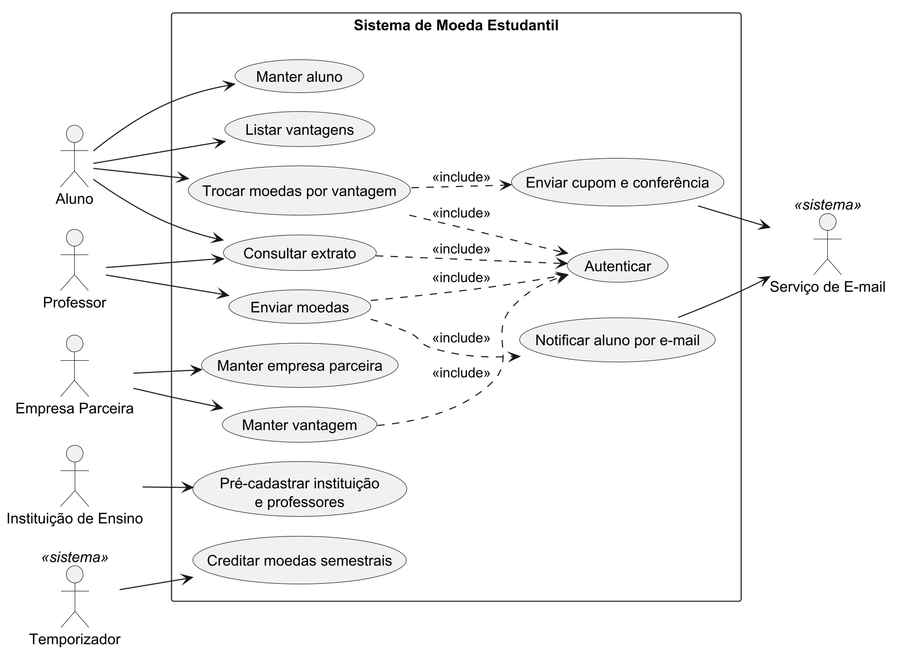
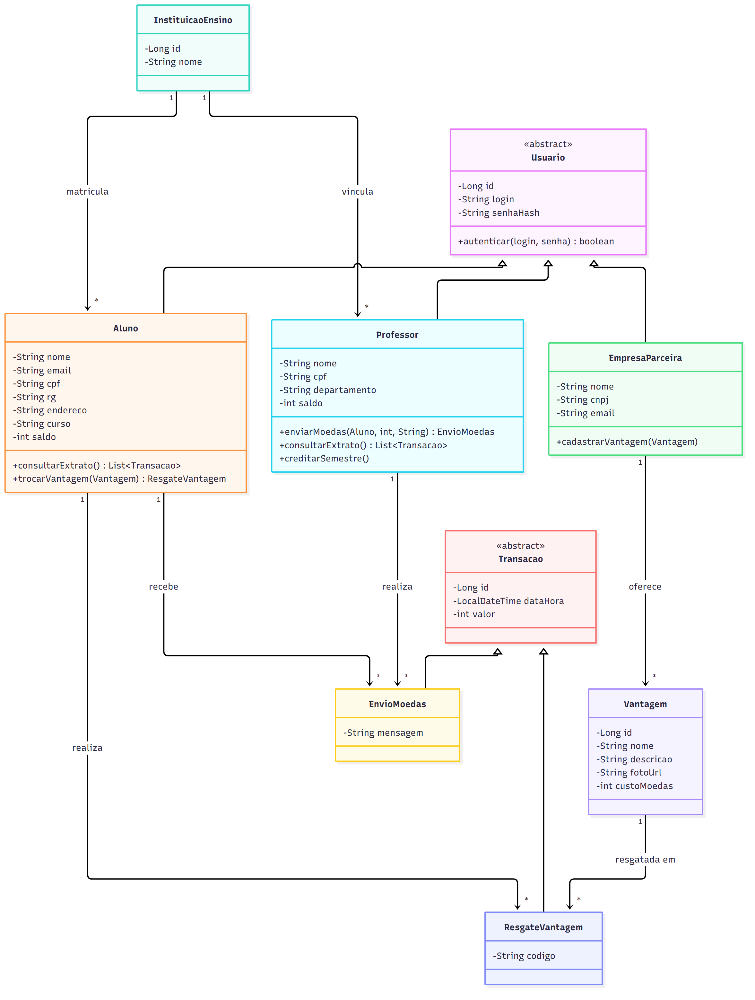
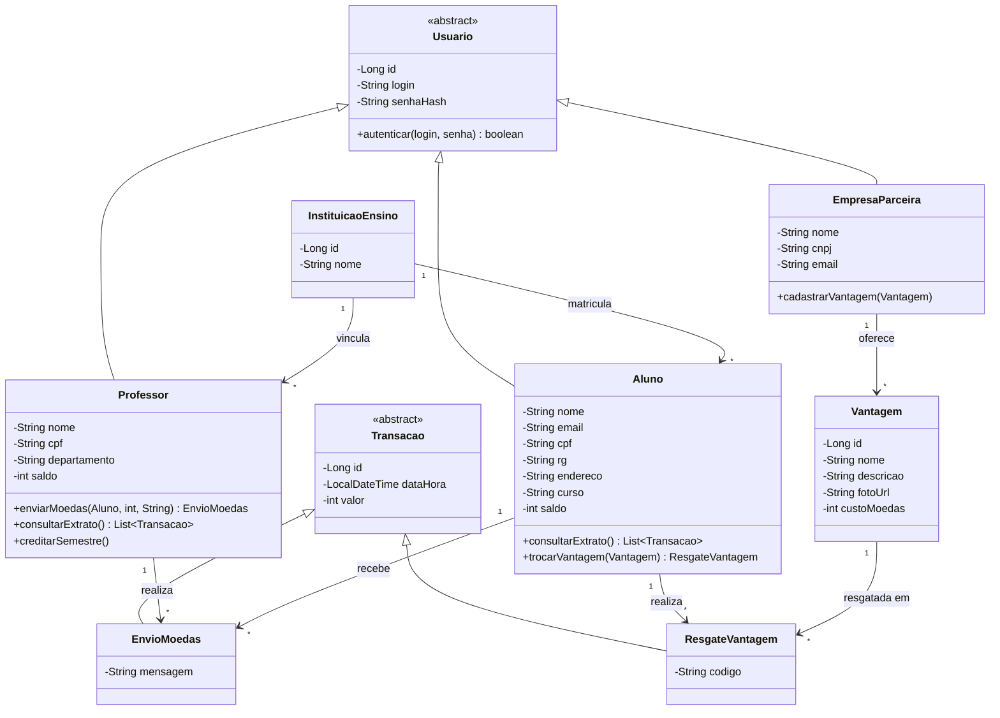
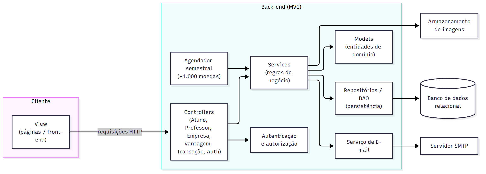
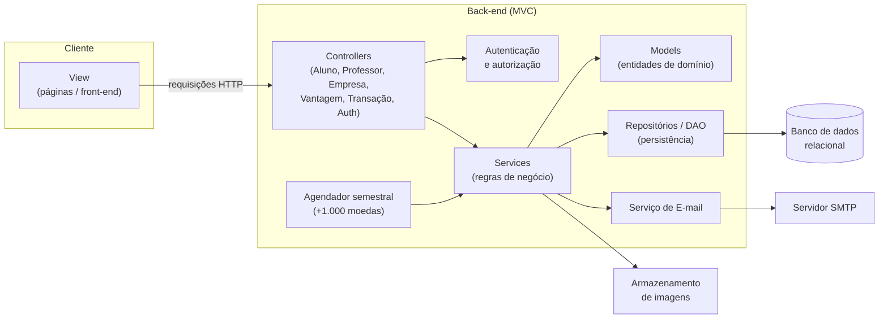

# Sistema de Moeda Estudantil — Sprint 1 (Lab03S01)

Modelagem do sistema: Diagrama de Casos de Uso, Histórias do Usuário, Diagrama de Classes e Diagrama de Componentes.

> Os diagramas de classes e de componentes usam Mermaid (renderizam direto no GitHub). O diagrama de casos de uso está em PlantUML no arquivo `casos-de-uso.puml` (renderize em plantuml.com ou na extensão do VS Code).

---

## 1. Atores

| Ator | Descrição |
|---|---|
| Aluno | Se cadastra, recebe moedas, consulta extrato e troca moedas por vantagens |
| Professor | Pré-cadastrado pela instituição; envia moedas aos alunos e consulta extrato |
| Empresa Parceira | Se cadastra e oferece vantagens; recebe e-mail de conferência das trocas |
| Instituição de Ensino | Pré-cadastrada; envia a lista de professores no momento da parceria |
| Serviço de E-mail (sistema) | Ator secundário que dispara notificações e cupons |
| Temporizador (sistema) | Credita 1.000 moedas a cada professor a cada semestre |

---

## 2. Casos de Uso

| ID | Caso de uso | Ator(es) | Observações |
|---|---|---|---|
| UC01 | Autenticar (login/senha) | Aluno, Professor, Empresa | Pré-condição de todos os demais |
| UC02 | Manter aluno (CRUD) | Aluno | Nome, e-mail, CPF, RG, endereço, instituição, curso |
| UC03 | Manter empresa parceira (CRUD) | Empresa | Cadastro com login e senha |
| UC04 | Manter vantagem (CRUD) | Empresa | Descrição, foto e custo em moedas |
| UC05 | Pré-cadastrar instituição e professores | Instituição | Carga prévia, fora do fluxo do usuário final |
| UC06 | Enviar moedas | Professor | Exige saldo suficiente e mensagem obrigatória |
| UC07 | Notificar aluno por e-mail | Serviço de E-mail | `<<include>>` de UC06 |
| UC08 | Consultar extrato | Aluno, Professor | Saldo + transações |
| UC09 | Listar vantagens | Aluno | Catálogo de vantagens disponíveis |
| UC10 | Trocar moedas por vantagem | Aluno | Debita saldo e gera código |
| UC11 | Enviar cupom ao aluno e conferência ao parceiro | Serviço de E-mail | `<<include>>` de UC10; ambos com o mesmo código |
| UC12 | Creditar moedas semestrais | Temporizador | +1.000 moedas, acumulável |

Diagrama: ver `casos-de-uso.puml`.

---

## 3. Histórias de Usuário

**HU01 — Cadastro de aluno**
Como aluno, quero me cadastrar informando nome, e-mail, CPF, RG, endereço, instituição e curso, para participar do sistema de mérito.
- A instituição é escolhida em uma lista de instituições já cadastradas.
- CPF e e-mail não podem estar duplicados.
- Defino login e senha no cadastro.

**HU02 — Cadastro de empresa parceira**
Como empresa parceira, quero me cadastrar com login e senha, para oferecer vantagens aos alunos.

**HU03 — Autenticação**
Como aluno, professor ou empresa parceira, quero entrar com login e senha, para acessar apenas as funções do meu perfil.
- Sem autenticação, nenhuma funcionalidade é acessível.
- Credenciais inválidas exibem mensagem de erro.

**HU04 — Cadastro de vantagem**
Como empresa parceira, quero cadastrar vantagens com descrição, foto e custo em moedas, para que alunos possam trocá-las.
- Descrição, foto e custo são obrigatórios.
- Custo deve ser maior que zero.
- Posso editar e excluir minhas vantagens.

**HU05 — Professores pré-cadastrados**
Como instituição de ensino, quero enviar a lista de professores na parceria, para que eles já tenham acesso ao sistema.
- Cada professor tem nome, CPF e departamento, vinculado explicitamente à instituição.

**HU06 — Crédito semestral**
Como professor, quero receber 1.000 moedas a cada semestre, para reconhecer meus alunos.
- O saldo é acumulável: moedas não usadas permanecem e as novas 1.000 são somadas.

**HU07 — Enviar moedas**
Como professor, quero enviar moedas a um aluno informando o motivo, para reconhecer seu mérito.
- Só é possível enviar se o saldo for suficiente.
- A mensagem de motivo é obrigatória e aberta.
- Meu saldo é reduzido e o do aluno aumentado.

**HU08 — Notificação de recebimento**
Como aluno, quero ser notificado por e-mail ao receber moedas, para saber que fui reconhecido.

**HU09 — Extrato do aluno**
Como aluno, quero consultar meu extrato, para ver meu saldo e meu histórico de recebimentos e trocas.

**HU10 — Extrato do professor**
Como professor, quero consultar meu extrato, para ver meu saldo e as moedas que enviei.

**HU11 — Consultar vantagens**
Como aluno, quero ver as vantagens disponíveis com foto, descrição e custo, para escolher o que trocar.

**HU12 — Trocar moedas por vantagem**
Como aluno, quero resgatar uma vantagem usando minhas moedas, para obter descontos e produtos.
- Só é possível com saldo suficiente.
- O valor é debitado do meu saldo.
- O sistema gera um código único para a troca.

**HU13 — Cupom por e-mail**
Como aluno, quero receber um e-mail com cupom e código, para usar na troca presencial.

**HU14 — Conferência pelo parceiro**
Como empresa parceira, quero receber um e-mail com o mesmo código da troca, para conferir o resgate do aluno.

---

## 4. Diagrama de Classes

**Decisões de modelagem**
- `Usuario` concentra login e senha, pois os três perfis precisam autenticar.
- `Transacao` generaliza envio e resgate, o que facilita montar o extrato (professor vê `EnvioMoedas`; aluno vê `EnvioMoedas` recebidos e `ResgateVantagem`).
- O `codigo` do `ResgateVantagem` é o mesmo enviado nos dois e-mails (aluno e parceiro).
- O vínculo do professor com a instituição é obrigatório (`1` → `*`).

---

## 5. Diagrama de Componentes (arquitetura MVC)

| Componente | Responsabilidade |
|---|---|
| View | Telas de cadastro, login, extrato, catálogo de vantagens |
| Controllers | Recebem requisições, validam entrada e delegam aos serviços |
| Services | Regras: saldo suficiente, débito/crédito, geração de código |
| Models | Entidades do diagrama de classes |
| Repositórios / DAO | Acesso ao banco (estratégia ORM/DAO definida na Sprint 2) |
| Autenticação | Login, senha com hash e controle de acesso por perfil |
| Serviço de E-mail | Notificação de moedas, cupom ao aluno e conferência ao parceiro |
| Agendador | Crédito semestral de moedas aos professores |

> Tecnologias ainda não fixadas: a escolha da stack fica para a Sprint 2, e os componentes acima são independentes dela.
