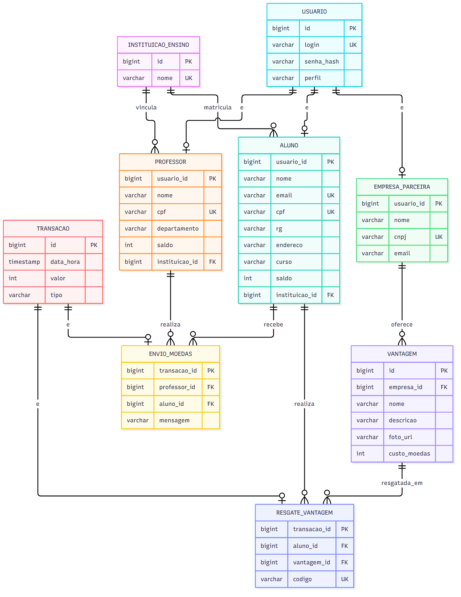
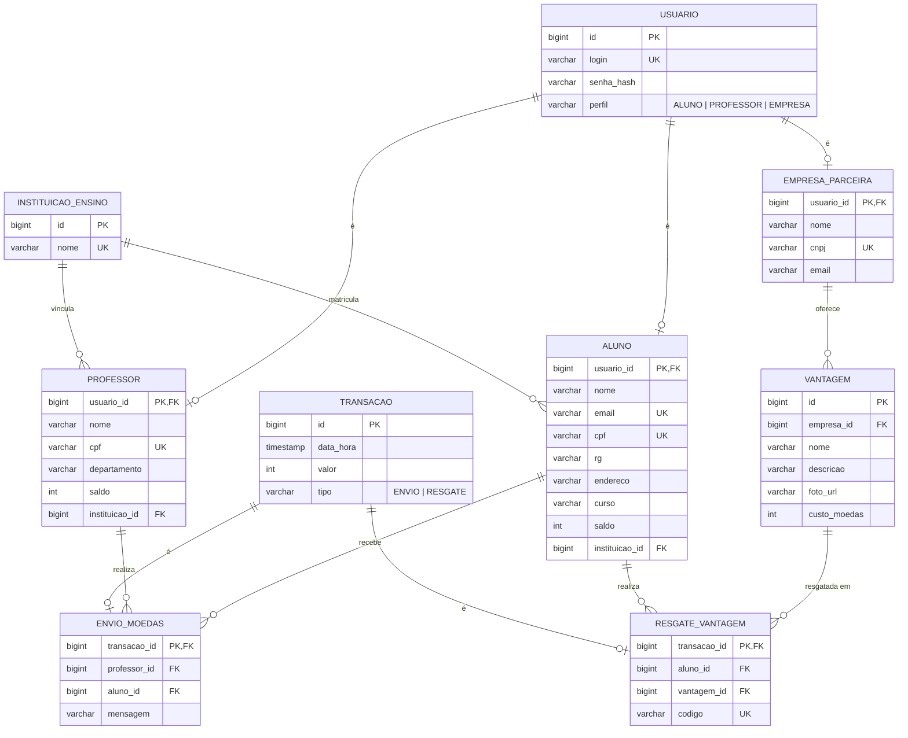

# Sistema de Moeda Estudantil — Sprint 2 (Lab03S02)

Entregas: Modelo ER, estratégia de acesso ao banco de dados (ORM, padrão DAO) e CRUDs de Aluno e Empresa Parceira (versão inicial: front-end e comunicação com o back-end).

---

## 1. Modelo Entidade-Relacionamento





### Restrições principais

| Tabela | Restrição |
|---|---|
| `usuario` | `login` único; `senha_hash` nunca em texto puro (BCrypt) |
| `aluno` | `cpf` e `email` únicos; `instituicao_id` obrigatório; `saldo >= 0` |
| `professor` | `cpf` único; `instituicao_id` obrigatório; `saldo >= 0` |
| `empresa_parceira` | `cnpj` único |
| `vantagem` | `custo_moedas > 0`; `empresa_id` obrigatório |
| `envio_moedas` | `mensagem` obrigatória (`NOT NULL`, não vazia); `valor > 0` |
| `resgate_vantagem` | `codigo` único (é o mesmo enviado nos dois e-mails) |

### Decisões de modelagem

- **Herança em tabelas separadas (joined):** `usuario` guarda o que é comum (login, senha, perfil), e `aluno`, `professor` e `empresa_parceira` guardam os dados específicos, com `usuario_id` como PK e FK. Evita colunas nulas e mantém um único ponto de autenticação.
- **Mesmo padrão em `transacao`:** facilita montar o extrato com uma consulta só e ainda separa os campos de envio e de resgate.
- **Instituição e professores sem CRUD:** são carregados previamente (seed), como pede o enunciado.
- **Saldo na própria entidade:** `saldo` fica em `aluno` e `professor` para consulta rápida. A consistência vem do fato de toda movimentação gerar uma `transacao`, e débito e crédito acontecem na mesma transação do banco.

---

## 2. Estratégia de acesso ao banco de dados

| Aspecto | Escolha | Motivo |
|---|---|---|
| Mapeamento objeto-relacional | **JPA com Hibernate (ORM)** | As entidades do diagrama de classes viram tabelas por anotações, sem SQL manual |
| Padrão DAO | **Spring Data JPA** (interfaces `*Repository`) | Cada repositório é o DAO da sua entidade, isolando o acesso a dados da regra de negócio |
| Herança | `@Inheritance(strategy = JOINED)` | Reflete o modelo ER acima |
| Transações | `@Transactional` na camada de serviço | Envio de moedas e resgate alteram vários registros e precisam ser atômicos |
| Consultas específicas | Métodos derivados e `@Query` (JPQL) | Ex.: busca por CPF, extrato por aluno |
| Banco em desenvolvimento | H2 em memória | Sobe sem instalação, bom para todos do grupo |
| Banco em produção | PostgreSQL | Configurado por variáveis de ambiente |
| Esquema | `ddl-auto=update` em dev; scripts versionados quando fechar o modelo | Evita divergência entre o código e o banco |

### Camadas

```
Controller  →  Service (@Transactional)  →  Repository (DAO)  →  Entity (ORM)  →  Banco
   HTTP          regras de negócio           Spring Data JPA        JPA/Hibernate
```

- O controller nunca acessa o repositório diretamente.
- O serviço recebe e devolve DTOs ou entidades, e valida as regras (CPF duplicado, saldo etc.).
- O repositório só conhece persistência.

---

## 3. CRUDs desta sprint (versão inicial)

### Aluno
| Operação | Rota | Observações |
|---|---|---|
| Listar | `GET /alunos` | Lista simples |
| Formulário de cadastro | `GET /alunos/novo` | Instituição escolhida em lista |
| Criar | `POST /alunos` | Cria `usuario` + `aluno`; senha em BCrypt; rejeita CPF ou e-mail duplicado |
| Formulário de edição | `GET /alunos/{id}/editar` | |
| Atualizar | `POST /alunos/{id}` | Não altera saldo |
| Excluir | `POST /alunos/{id}/excluir` | Bloquear se houver transações (ou exclusão lógica) |

### Empresa parceira
| Operação | Rota | Observações |
|---|---|---|
| Listar | `GET /empresas` | |
| Formulário de cadastro | `GET /empresas/novo` | |
| Criar | `POST /empresas` | Cria `usuario` + `empresa_parceira`; rejeita CNPJ duplicado |
| Formulário de edição | `GET /empresas/{id}/editar` | |
| Atualizar | `POST /empresas/{id}` | |
| Excluir | `POST /empresas/{id}/excluir` | Bloquear se houver vantagens resgatadas |

**Validações comuns:** campos obrigatórios, formato de e-mail, CPF/CNPJ válidos e mensagens de erro exibidas no formulário.

---

## 4. Pendências para a Sprint 3

- CRUDs em versão final (refinar validações e telas).
- Apresentação da arquitetura e da camada de persistência (slides).
- Tutorial das tecnologias escolhidas e protótipo final.
